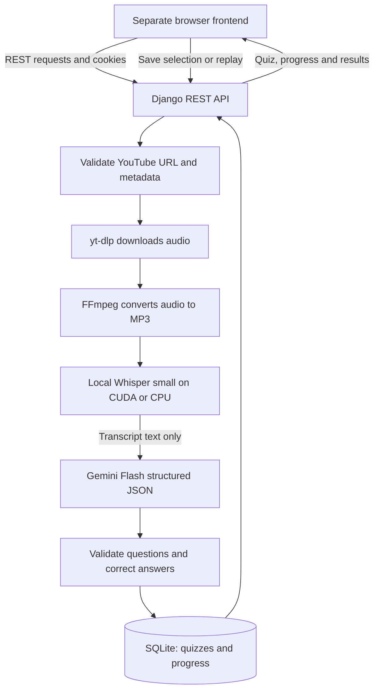

# Quizly

**Turn YouTube videos into personal, playable quizzes.**

Quizly is a Django REST backend built as a Developer Akademie final project. It
helps learners check what they understood from a video: submit a YouTube URL,
generate ten multiple-choice questions, play the quiz, and review the answers.
Progress is saved automatically, so learners can return later or change an answer.

Audio is transcribed **locally with open-source OpenAI Whisper**. The transcript
is then sent to Google Gemini Flash for structured quiz generation. Quizly does
not use the paid OpenAI transcription API and does not require an OpenAI API key.

[Backend repository](https://github.com/angelo-niessen-93/Quizly) ·
[Official Developer Akademie frontend](https://github.com/Developer-Akademie-Backendkurs/project.Quizly)

## Table of contents

- [Features](#features)
- [Technology stack](#technology-stack)
- [Architecture](#architecture)
- [Frontend repository and integration](#frontend-repository-and-integration)
- [Installation and setup](#installation-and-setup)
- [Environment variables](#environment-variables)
- [API documentation](#api-documentation)
- [Authentication and security](#authentication-and-security)
- [Django administration](#django-administration)
- [Testing and verified results](#testing-and-verified-results)
- [Troubleshooting](#troubleshooting)
- [Security and deployment](#security-and-deployment)
- [Additional documentation](#additional-documentation)
- [Credits and acknowledgements](#credits-and-acknowledgements)

## Features

- Register with username, email, password, and password confirmation; validate
  passwords and reject duplicate emails regardless of letter case.
- Sign in with JWT access and refresh tokens stored exclusively in HTTP-only
  cookies. Refresh rotates the session; logout clears cookies and revokes it.
- Process supported public YouTube video URLs with yt-dlp, FFmpeg, local Whisper,
  and Gemini Flash.
- Validate exactly **ten distinct questions**, **four distinct options per
  question**, and **one correct solution** before storing a quiz.
- List, open, rename, describe, and delete your own quizzes; filter by today or
  the last seven calendar days.
- Save every answer selection, resume after reloading, and replace previous
  answers, including after completing a quiz.
- Calculate a percentage score, review correct solutions, and replay the same
  questions with saved selections reset.
- Manage quizzes and individual questions through Django admin.
- Use a separate responsive HTML/CSS/JavaScript frontend for authentication,
  the quiz library, quiz play, and results.

Frontend behavior was verified with the locally integrated copy described below.
Frontend files are not bundled with this backend.

## Technology stack

| Area | Technologies |
| --- | --- |
| Backend | Python, Django 6.1, Django REST Framework 3.18.0, SQLite |
| Authentication | Simple JWT 5.5.1 with token blacklist, Django CSRF, django-cors-headers 4.9.0 |
| Configuration | python-dotenv and environment-based Django settings |
| Audio and AI | yt-dlp, FFmpeg/FFprobe, openai-whisper 20250625, PyTorch, optional NVIDIA CUDA, Google GenAI SDK and Gemini Flash |
| Separate frontend | HTML5, CSS with media queries, vanilla JavaScript, Fetch API; no application framework or build step |
| Tests and quality | Django/DRF tests, unittest mocks, HTTPX MockTransport, Ruff, custom AST checks; Node.js built-in frontend tests |

Dependency pins and ranges are in [requirements.txt](requirements.txt) and
[requirements-dev.txt](requirements-dev.txt). The verified Windows environment
used Python 3.14.2, FFmpeg/FFprobe 9.0.2, Google GenAI 2.31.0, and Node.js 24.16.0.
GPU transcription was verified with an RTX 5070 Ti and PyTorch 2.14.1+cu130.
CUDA is optional; automatic device selection falls back to CPU.

## Architecture

**YouTube URL → yt-dlp → FFmpeg → local Whisper → Gemini Flash → validated
Django REST content → SQLite → frontend.**



Generation is synchronous: POST waits for processing, transcription, generation,
validation, and storage. There is no background queue or job-status endpoint.
The first Whisper request also downloads model weights.

Quiz creation is atomic. Temporary audio is removed on success and failure; the
normal pipeline does not permanently store audio or transcripts. Whisper weights
remain cached, and the loaded model is reused once per process. A lock serializes
model loading and transcription within that process.

The models are `User`, `Quiz`, `Question`, `Answer`, `Progress`, and
`SelectedAnswer`. Each quiz has an owner and one current progress record.
Selections are unique per question in that record. Replay resets the current
state; a history of previous attempts is not retained.

```text
Quizly/
|-- apps/
|   |-- accounts/       # Custom user, cookie JWT authentication, CSRF, token services
|   `-- quizzes/        # Models, API, generation, audio, validation, admin, tests
|-- quizly/             # Settings, root URLs, WSGI/ASGI, isolated test settings
|-- scripts/            # Quality check and offline Gemini request preparation
|-- docs/               # DoD mapping and integration evidence
|-- .env.example        # Public configuration template without credentials
|-- manage.py
|-- requirements.txt
`-- requirements-dev.txt
```

## Frontend repository and integration

The frontend is supplied by **Developer Akademie**:

**[Developer-Akademie-Backendkurs/project.Quizly](https://github.com/Developer-Akademie-Backendkurs/project.Quizly)**

The original repository is not owned by this backend's author. Clone or download
it separately, keep its own Git repository, and retain its license and attribution.
Frontend and backend communicate exclusively through the REST API.

Use sibling folders, never a frontend folder inside the backend:

```text
quizly-workspace/
|-- Quizly/             # This backend repository
`-- Quizly-Frontend/    # Separate frontend repository
```

The verified local frontend copy includes these integration changes:

- `shared/js/config.js`: API base URL `http://127.0.0.1:8000/api/`.
- `shared/js/auth.js`: credentialed requests, CSRF bootstrap/header handling,
  and refresh on HTTP 401 rather than on CSRF/ownership 403 responses.
- `shared/js/progress.js`: a `QuizProgress` controller that maps option text to
  answer IDs and serializes progress writes.
- `shared/js/quiz.js` and `pages/quiz.html`: load saved progress, autosave every
  selection, restore selections, handle failed saves, and invoke replay.
- `tests/progress.test.cjs`: nine regression tests for this integration.

**Fresh-clone limitation:** the inspected official upstream snapshot does not
contain these local CSRF/progress additions. Cloning upstream alone does not
reproduce the verified integrated frontend. Use the separately supplied integrated
copy, or apply equivalent changes there before following the browser walkthrough.
This backend contains neither the frontend nor a frontend patch. A public URL
for the adapted frontend repository has not been supplied. Do not disable backend
CSRF protection to make an unadapted frontend work.

## Installation and setup

### 1. Prerequisites

For Windows, install:

- [Python](https://www.python.org/downloads/) with `python` available in PowerShell.
  Python 3.14 is tested; Django 6.1 requires Python 3.12 or newer.
- [Git](https://git-scm.com/downloads).
- FFmpeg and FFprobe, installed in step 4.
- A modern browser and internet access for YouTube, model weights, and Gemini.
- A Gemini API key for automatic generation; check its project tier and quotas.
- Optionally, a compatible NVIDIA driver and CUDA-enabled PyTorch for GPU use.
- Optionally, [Node.js](https://nodejs.org/en/download) for frontend tests.
  Node.js is not required to serve the static frontend.

Check `python --version` and `git --version`. The commands below assume a new
installation. Reuse existing folders and configuration instead of overwriting them.

### 2. Clone the projects separately

```powershell
mkdir quizly-workspace
cd quizly-workspace
git clone https://github.com/angelo-niessen-93/Quizly.git Quizly
git clone https://github.com/Developer-Akademie-Backendkurs/project.Quizly.git Quizly-Frontend
cd Quizly
```

The second clone is the official baseline, not the adapted local copy. Resolve
the [frontend integration prerequisite](#frontend-repository-and-integration)
before expecting CSRF-protected authentication and persisted progress to work.

### 3. Create a virtual environment and install dependencies

From the backend folder:

```powershell
python -m venv .venv
.\.venv\Scripts\Activate.ps1
python -m pip install --upgrade pip
```

All subsequent Python commands assume the backend virtual environment is active
unless stated otherwise.

If PowerShell blocks activation, use the session-only option
`Set-ExecutionPolicy -Scope Process -ExecutionPolicy Bypass`, then activate again.
Alternatively, invoke `.\.venv\Scripts\python.exe` directly.

For the verified RTX 5070 Ti environment, this CUDA wheel was installed **before**
the requirements installation:

```powershell
python -m pip install torch==2.14.1+cu130 --index-url https://download.pytorch.org/whl/cu130
```

For other hardware, use the [official PyTorch selector](https://pytorch.org/get-started/locally/).
The recorded wheel is a tested example, not a requirement for every machine.
Installing a CUDA toolkit alone does not make CPU-only PyTorch GPU-enabled.

Now install the project dependencies, whether using CPU or CUDA:

```powershell
python -m pip install -r requirements-dev.txt
```

`requirements-dev.txt` includes runtime dependencies and Ruff. For an installation
without development tools, use `requirements.txt` instead. A compatible CUDA
wheel installed above satisfies the project's PyTorch dependency.

Check the runtime without loading Whisper or contacting an AI service:

```powershell
python -c "import torch; print('PyTorch:', torch.__version__); print('CUDA available:', torch.cuda.is_available()); print('CUDA runtime:', torch.version.cuda)"
```

### 4. Install FFmpeg and verify FFprobe

On Windows with WinGet:

```powershell
winget install --id Gyan.FFmpeg -e
```

Open a new terminal afterward, return to the backend folder, and reactivate the
virtual environment. Verify both executables:

```powershell
ffmpeg -version
ffprobe -version
```

An FFmpeg Python package does not replace these programs. If they are not on
`PATH`, set `FFMPEG_LOCATION` in `.env` to their shared directory. Quizly adds
that directory to its process `PATH` so local Whisper can find FFmpeg too.

### 5. Configure environment variables and Gemini

Copy the template only if `.env` does not already exist:

```powershell
if (-not (Test-Path .env)) { Copy-Item .env.example .env }
```

For a **new installation**, generate a private Django secret directly into `.env`
without displaying it:

```powershell
python -c "import secrets; from dotenv import set_key; set_key('.env', 'DJANGO_SECRET_KEY', secrets.token_urlsafe(64))"
```

This replaces that variable. Skip it when reusing a valid installation. Rotating
the signing key invalidates existing signed sessions and JWTs. Never reuse an old
publicly exposed key or a value starting with `django-insecure-`.

Edit `.env` and enter your own `GEMINI_API_KEY` privately. Obtain it from
[Google AI Studio](https://aistudio.google.com/api-keys), then check the project's
billing tier, model availability, and rate limits. The template intentionally
leaves credentials empty.

The local template selects Gemini `gemini-3.8-flash`, Whisper `small`, HTTP cookie
settings, and the frontend origin on port 5500. Do not commit `.env`. Restart
Django after changes; exported process variables override file values.

Check key presence without displaying it or calling Google:

```powershell
python manage.py shell -c "from django.conf import settings; print('Gemini configured:', bool(settings.GEMINI_API_KEY.strip()))"
```

### 6. Apply migrations and start Django

```powershell
python manage.py migrate
python manage.py check
python manage.py createsuperuser
python manage.py runserver 127.0.0.1:8000
```

The superuser is optional unless you need admin access. Keep the server terminal
open. Check [the CSRF endpoint](http://127.0.0.1:8000/api/csrf/) for JSON;
`/api/` itself is a prefix, not a homepage or health endpoint. Admin is available
at [the admin URL](http://127.0.0.1:8000/admin/).

Back up existing databases before migrations; do not delete data to fix errors.
Migration `0002_api_contract_fields` preserves content while renaming the stored
URL field and adding timestamps. An older database using Django's standard user
model needs a separate migration plan.

### 7. Configure and serve the frontend separately

In the integrated frontend's `shared/js/config.js`, confirm:

```javascript
const API_BASE_URL = "http://127.0.0.1:8000/api/";
```

Keep the trailing slash. Open another terminal in `quizly-workspace`:

```powershell
cd Quizly-Frontend
python -m http.server 5500 --bind 127.0.0.1
```

No npm installation or build is needed. Open
[Quizly in your browser](http://127.0.0.1:5500/). Use `127.0.0.1` consistently for
both projects rather than mixing it with `localhost`. Do not open HTML with `file://`.

### 8. Generate and play the first quiz

1. Register through the integrated frontend, then log in.
2. Submit a short public video with clear speech in the quiz library. The verified
   example was [this TED-Ed video](https://www.youtube.com/watch?v=rb7TVW77ZCs).
3. Wait for processing. The initial model download and CPU transcription can take
   considerably longer than subsequent requests.
4. Open the quiz overview and start playing. Each selection saves immediately.
5. Reload to resume, change earlier answers if needed, and finish all ten questions
   to see the percentage result and correct solutions.
6. Choose replay to reset the saved attempt and play the existing quiz again.

Submitting a URL makes a real Gemini request. A free model offering does not
prove your key's project uses the Free Tier. Check
[current pricing](https://ai.google.dev/gemini-api/docs/pricing) and
[project limits](https://ai.google.dev/gemini-api/docs/rate-limits).
There is no automatic Gemini retry, continuation, or model fallback.

### Linux and macOS

These are equivalent instructions, not a separately verified installation:

```bash
python3 -m venv .venv
source .venv/bin/activate
python -m pip install --upgrade pip
python -m pip install -r requirements-dev.txt
test -f .env || cp .env.example .env
```

Generate the signing key and edit `.env` as above. On Ubuntu/Debian, install audio
tools with `sudo apt update && sudo apt install ffmpeg`; on macOS with Homebrew,
use `brew install ffmpeg`. Verify both executables, then use the same migration,
backend, and frontend-server commands.

## Environment variables

Django loads `.env` beside `manage.py` using python-dotenv. Exported process
variables take precedence. Use `true`/`false` for booleans and comma-separated
lists without spaces. Allowed hosts contain hostnames only; CORS and CSRF origins
include scheme and port.

| Variable | Required? | Default without `.env` | Local example / purpose |
| --- | --- | --- | --- |
| `DJANGO_SECRET_KEY` | Always | None; missing/insecure-prefix values prevent startup | Generate privately in step 5; signs sessions and JWTs |
| `DJANGO_DEBUG` | Optional | `false` | `true` for local development only |
| `DJANGO_ALLOWED_HOSTS` | Optional; configure for hosting | `localhost,127.0.0.1` | Hostnames accepted by Django |
| `COOKIE_SECURE` | Optional | `true` | `false` only for local HTTP; affects JWT, session, and CSRF cookies |
| `COOKIE_SAMESITE` | Optional | `Lax` | `Lax` for the same-site local setup |
| `SECURE_SSL_REDIRECT` | Optional | `true` | `false` only for local HTTP |
| `CSRF_TRUSTED_ORIGINS` | Needed for cross-origin browser writes | Empty | `http://127.0.0.1:5500`; template also allows localhost |
| `CORS_ALLOWED_ORIGINS` | Needed for a separate browser origin | Empty | `http://127.0.0.1:5500`; template also allows localhost |
| `GEMINI_API_KEY` | Automatic generation only | Empty | Set your key privately; never publish it |
| `GEMINI_MODEL` | Optional | `gemini-3.8-flash` | Must support the configured thinking and structured output |
| `GEMINI_TIMEOUT_SECONDS` | Optional | `180` | Positive requested server deadline; HTTPX gets ten extra seconds |
| `GEMINI_MAX_OUTPUT_TOKENS` | Optional | `8192` | Positive output cap including thinking tokens |
| `WHISPER_MODEL` | Optional | `small` | Local model; weights download on first use |
| `WHISPER_DEVICE` | Optional | `auto` | `auto`, `cpu`, or `cuda`; automatic CPU fallback |
| `WHISPER_CACHE_DIR` | Optional | Backend `.cache/whisper` | Directory for reusable model weights |
| `FFMPEG_LOCATION` | Optional if tools are on `PATH` | Empty | Directory containing FFmpeg and FFprobe |

The template's local HTTP settings deliberately differ from secure application
defaults. `.env`, SQLite, model weights, and integration artifacts are ignored by
Git. The transcription code does not consume `OPENAI_API_KEY`.

## API documentation

Base URL: `http://127.0.0.1:8000/api/`. Keep trailing slashes. JSON bodies use
`Content-Type: application/json`. JWTs are accepted only through cookies, not
through request-body token fields or Bearer headers.

### Endpoint overview

"Access" means a valid access cookie. Every POST, PATCH, and DELETE also needs
valid CSRF protection. Refresh and logout work after access-token expiry.

| Method | Endpoint | Authentication | Purpose / success |
| --- | --- | --- | --- |
| GET | `/api/csrf/` | Public | CSRF cookie and masked token; 200 |
| POST | `/api/register/` | Public + CSRF | Register user; 201 |
| POST | `/api/login/` | Public + CSRF | Set access/refresh cookies; 200 |
| POST | `/api/token/refresh/` | Refresh cookie + CSRF | Rotate session; 200 |
| POST | `/api/logout/` | CSRF; refresh cookie revokes session | Clear JWT cookies; 200 |
| POST | `/api/quizzes/` | Access | Generate and store owned quiz; 201 |
| GET | `/api/quizzes/` | Access | List own quizzes; 200 |
| GET | `/api/quizzes/{id}/` | Access + ownership | Retrieve quiz; 200 |
| PATCH | `/api/quizzes/{id}/` | Access + ownership | Edit title/description; 200 |
| DELETE | `/api/quizzes/{id}/` | Access + ownership | Delete related content; 204, no body |
| GET | `/api/quizzes/{id}/progress/` | Access + ownership | Read attempt and playable answer IDs; 200 |
| PATCH | `/api/quizzes/{id}/progress/` | Access + ownership | Save or replace one selection; 200 |
| POST | `/api/quizzes/{id}/replay/` | Access + ownership | Reset selections, increment attempt; 200 |

### CSRF and browser requests

`GET /api/csrf/` has no body and returns HTTP 200:

```json
{"csrfToken": "<masked-csrf-token>"}
```

The bracketed value represents the actual response; it is not a usable token.
The response also establishes a CSRF cookie. Before an unsafe request, fetch this
endpoint with credentials included and send the returned value as `X-CSRFToken`.
For example, from the allowed frontend origin:

```javascript
const api = "http://127.0.0.1:8000/api/";
const bootstrap = await fetch(`${api}csrf/`, { credentials: "include" });
const { csrfToken } = await bootstrap.json();
const response = await fetch(`${api}login/`, {
  method: "POST",
  credentials: "include",
  headers: { "Content-Type": "application/json", "X-CSRFToken": csrfToken },
  body: JSON.stringify({ username: "learner", password: "ExampleOnly!Quiz72z" }),
});
```

All example identities and passwords are fictional; use your own registered
credentials. Login rotates the CSRF secret: obtain a fresh token after login,
or before every subsequent unsafe request, as the integrated frontend does.
Never read JWTs from JavaScript or store them in localStorage.

### Registration, login, refresh, and logout

**Register:** `POST /api/register/`

```json
{
  "username": "learner",
  "email": "learner@example.com",
  "password": "ExampleOnly!Quiz72z",
  "confirmed_password": "ExampleOnly!Quiz72z"
}
```

HTTP 201:

```json
{"detail": "User created successfully!"}
```

Registration does not log the user in. Invalid fields, duplicate usernames/emails,
weak passwords, and mismatched confirmation return 400. Django checks minimum
length (eight characters), common/numeric passwords, and similarity to user data.
Backend validation remains authoritative over frontend hints.

**Login:** `POST /api/login/`

```json
{"username": "learner", "password": "ExampleOnly!Quiz72z"}
```

HTTP 200, using the actual user's ID and identity:

```json
{
  "detail": "Login successfully!",
  "user": {"id": 1, "username": "learner", "email": "learner@example.com"}
}
```

Both tokens are set as HTTP-only cookies; neither appears in JSON. Missing
credentials, unknown users, and incorrect passwords return the same generic 401:
`{"detail": "Invalid username or password."}`.

**Refresh:** `POST /api/token/refresh/`, no JSON body required. The refresh cookie
is the input. HTTP 200:

```json
{"detail": "Token refreshed"}
```

Refresh sets a new access cookie and rotates the refresh cookie. The old session
is blacklisted. A missing, expired, or revoked refresh cookie returns 401.

**Logout:** `POST /api/logout/`, no JSON body required. HTTP 200:

```json
{"detail": "Log-Out successfully! All Tokens will be deleted. Refresh token is now invalid."}
```

Logout clears both cookies and blacklists a valid supplied refresh token. It is
idempotent if that token is missing or already invalid. It affects the current
session, not every device. CSRF is still required.

### Generate a quiz

`POST /api/quizzes/`:

```json
{"url": "https://www.youtube.com/watch?v=rb7TVW77ZCs"}
```

The request field is **`url`**; the response/database field is **`video_url`**.
The owner is always the signed-in user. Success is HTTP 201 with the
[quiz response](#quiz-response). Invalid input returns 400, generation failures
return a safe 502, and missing Gemini/audio-tool configuration returns 503.

Supported forms are HTTPS single-video watch, shorts, embed, and youtu.be links
on `youtube.com`, `www.youtube.com`, `m.youtube.com`, and `youtu.be`, as appropriate
for the URL form. URLs are canonicalized. Other hosts, embedded credentials,
explicit ports, fragments, invalid IDs, and standalone playlist URLs are rejected.

Videos must be recorded, have a known duration, and be no longer than 20 minutes.
Downloads are bounded to 100 MiB; the MP3 must be nonempty and below 24 MiB.
A syntactically valid URL does not guarantee that the video is accessible.

### Quiz response

Create, detail GET, and PATCH return the same structure. This **abbreviated
example shows one question**; a real quiz response contains all ten.

```json
{
  "id": 1,
  "title": "The Science of Vaccines",
  "description": "A quiz about the source video's explanation of vaccines.",
  "created_at": "2026-10-15T12:00:00+02:00",
  "updated_at": "2026-10-15T12:00:00+02:00",
  "video_url": "https://www.youtube.com/watch?v=rb7TVW77ZCs",
  "questions": [
    {
      "id": 11,
      "question_title": "In what year did Edward Jenner administer the first vaccine?",
      "question_options": ["1796", "1896", "1756", "1812"],
      "answer": "1796",
      "created_at": "2026-10-15T12:00:00+02:00",
      "updated_at": "2026-10-15T12:00:00+02:00"
    }
  ]
}
```

IDs are integers; timestamps are ISO-8601 strings. `question_options` contains
four strings. `answer` is the correct answer **text**, not an index or ID, and is
included even before completion. Progress uses a separate representation below.

### List, retrieve, edit, and delete

- `GET /api/quizzes/`: HTTP 200 with an unpaginated array of your quiz objects;
  a new empty library returns `[]`. Results are newest first by creation time,
  then ID. Other users' quizzes are excluded.
- `GET /api/quizzes/?period=today`: same response for today's quizzes.
- `GET /api/quizzes/?period=week`: same response for today and the previous six
  calendar days. Date boundaries use `Europe/Berlin`, not a rolling 168-hour range.
  An unsupported `period` value returns 400.
- `GET /api/quizzes/1/`: HTTP 200 with the full quiz object described above.
- `PATCH /api/quizzes/1/`: update either or both editable metadata fields:

```json
{"title": "My revised title", "description": "My revised description"}
```

PATCH returns HTTP 200 with the full quiz object, changed metadata, and a new
`updated_at`. Questions, answers, and progress are preserved. Owner and video URL
are not editable through this endpoint.

`DELETE /api/quizzes/1/` requires no body and deletes the quiz, questions, answers,
progress, and selections. Success is **204 with no response body**; do not parse
JSON from it. For detail and play endpoints, a foreign existing quiz returns 403
and a nonexistent ID returns 404.

### Progress, scoring, and replay

`GET /api/quizzes/1/progress/` requires no body and returns HTTP 200. This is an
abbreviated example containing one of ten playable questions:

```json
{
  "attempt": 1,
  "completed": false,
  "updated_at": "2026-10-15T12:01:00+02:00",
  "selections": [{"question": 11, "answer": 21}],
  "score": null,
  "questions": [
    {
      "id": 11,
      "question": "In what year did Edward Jenner administer the first vaccine?",
      "position": 1,
      "answers": [
        {"id": 21, "text": "1796"},
        {"id": 22, "text": "1896"},
        {"id": 23, "text": "1756"},
        {"id": 24, "text": "1812"}
      ],
      "correct_answer": null
    }
  ]
}
```

`PATCH /api/quizzes/1/progress/` saves one selection using IDs from that response:

```json
{"question": 11, "answer": 21}
```

It returns HTTP 200 with the updated progress object. Another answer for the same
question replaces the selection. Both IDs must belong together and to this quiz;
invalid combinations return 400.

After all ten questions are answered, `completed` is `true`, `score` is the correct
answer percentage from 0 to 100, and each progress question's `correct_answer`
becomes its correct answer ID. Before completion, score and solution IDs are
`null`. Changing a completed answer recalculates the score.

`POST /api/quizzes/1/replay/` has no body and returns HTTP 200 with reset progress:
`attempt` increases, `completed` becomes `false`, `selections` becomes `[]`, and
score/solution IDs return to `null`. It reuses questions without calling Gemini.

### Optional manual creation

POST also accepts `title`, `description`, and `questions`. A complete question
list skips external generation. `url` remains required and validated. The list
must contain ten distinct items using this **input** shape:

```json
{
  "question": "Which number is even?",
  "answers": [
    {"text": "2", "is_correct": true},
    {"text": "3", "is_correct": false},
    {"text": "5", "is_correct": false},
    {"text": "7", "is_correct": false}
  ]
}
```

This one-item example is not a complete create request. Supply ten different
questions, each with four distinct options and exactly one true flag. Text limits
are 200 characters for title, 5000 for description, 1000 for question, and 500 for
answer. Manual creation defaults title to `Quiz` and description to empty.
Success remains HTTP 201 with the same public quiz response.

### Status codes and errors

| Code | Meaning |
| --- | --- |
| 200 / 201 / 204 | Successful read/write, creation, or bodyless deletion as documented above |
| 400 | Invalid registration, quiz content, URL, duration, date filter, or selection |
| 401 | Missing/invalid access authentication, invalid login, or unusable refresh token |
| 403 | Failed CSRF verification or another user's existing quiz |
| 404 | Requested quiz does not exist |
| 405 | Unsupported method, such as PUT on quiz detail |
| 429 | DRF throttling: 60 requests/minute anonymously, 120/minute authenticated |
| 500 | Unexpected internal failure; quiz persistence is transactional |
| 502 | Download, transcription, generation, or generated-content validation failed |
| 503 | Gemini key or FFmpeg/FFprobe configuration unavailable |

Field validation errors generally map field names to message lists. General
errors use `detail`, for example:

```json
{"detail": "Quiz generation failed. Please try again later."}
```

Credentials and raw provider errors are not returned to clients. The application
throttles are not guarantees of Gemini quota or availability.

## Authentication and security

- Access tokens last 15 minutes, refresh tokens seven days. Both cookies are
  HTTP-only, scoped to `/api/`, with configured Secure/SameSite flags.
- Refresh blacklists the old refresh token and issues a new pair. Access tokens
  contain a session reference checked against that blacklist, so revoking a valid
  session also invalidates its associated access token.
- Logout works after access expiry using the refresh cookie and CSRF. Rotation
  and revocation affect that session, not every login for the user.
- CSRF protection applies to public authentication writes and protected writes.
  The readable CSRF cookie is **not** a JWT.
- CORS allows credentials only for explicit frontend origins. Configure both
  CORS and CSRF; they serve different purposes.
- Users see only their own quiz lists; object permissions protect detail,
  progress, and replay operations. Admin access is separate.
- Django hashes passwords. Signing keys and API credentials come from the
  environment; real secrets do not belong in source control or screenshots.

## Django administration

Create a superuser, then log in at `/admin/`. Admin uses Django session
authentication rather than the REST API JWT cookies.

Administrators can search/filter quizzes, edit title/description, delete complete
quizzes, and open individual questions to edit text, options, and correct answers.
Admin validation preserves four distinct choices and one solution. Individual
questions cannot be added or deleted through admin; create complete quizzes
through the validated API. Administrators can manage users and view all owners'
quizzes.

## Testing and verified results

Run from the backend virtual environment:

```powershell
python manage.py test --settings=quizly.test_settings
python manage.py makemigrations --check --dry-run --settings=quizly.test_settings
python -m ruff check .
python -m ruff format --check .
python scripts/check_quality.py
python -m pip check
```

Test settings provide an isolated signing key, disable HTTPS redirection, and use
a fast test-only password hasher. Never use `quizly.test_settings` for development
or deployment. Tests create a separate test database and simulate providers;
they do not make paid generation requests.

The AST check enforces snake_case, docstrings, and at most 14 physical lines per
Python function, including tests. Coverage includes exact API contracts, cookies,
CSRF, permissions, CRUD, date filters, progress, replay, admin, migration
preservation, cleanup, and provider failures. Offline SDK tests check thinking,
schema, deadlines, and single-request behavior for errors, redirects, truncated
output, and continuation responses.

In the **separate integrated frontend folder**, run:

```powershell
node --test tests/progress.test.cjs
node --check shared/js/auth.js
node --check shared/js/quiz.js
node --check shared/js/progress.js
```

These nine tests use Node.js built-ins; no npm packages are required. The test
file and progress controller are local integration additions, not guaranteed
contents of a fresh official clone.

Latest confirmed local results, **15 October 2026**:

| Check | Confirmed result |
| --- | --- |
| Backend suite | 102 tests passed |
| Integrated frontend suite | 9 tests passed |
| Audio pipeline | Real YouTube download, FFmpeg conversion, and local CUDA Whisper verified |
| Optimized Gemini | One authorized real call: HTTP 200 in 13.460 seconds, finish reason STOP |
| Content | Ten valid questions, forty options, one correct solution per question |
| Persistence/API | SQLite verified; POST 201 and GET 200 with exact response fields |
| Real Edge browser | Quiz completed at 100%; autosave, reload, answer changes, and replay passed |

The final Gemini test reused the previously recorded 3834-character transcript
instead of downloading and transcribing again. Audio processing was verified in
earlier real runs. Temporary test accounts and quizzes were removed afterward.
See the integration report for the full evidence and scope. No live Gemini call
is required to run the automated tests.

Optional offline diagnostic:

```powershell
python scripts/prepare_gemini_test.py
```

It requires `.cache/flash38-transcript.txt` from the recorded integration run.
This ignored file is **not included in a fresh clone**. When present, the script
uses a dummy key and MockTransport to write an offline request manifest. It has
no live mode and is not a required installation step.

## Troubleshooting

| Problem | What to check |
| --- | --- |
| FFmpeg or FFprobe not found | Install both executables, reopen the terminal, verify both version commands, and set `FFMPEG_LOCATION` if needed. |
| CUDA unavailable | Run the PyTorch diagnostic; check the NVIDIA driver and CUDA-enabled wheel. Use `WHISPER_DEVICE=cpu` when needed. Forcing cuda does not install GPU support. |
| Whisper loads slowly | First use downloads weights and loads the model; later calls reuse it per process. CPU use and restarts can increase latency. Check disk/network access and the cache. |
| Gemini key appears empty | Use exactly `GEMINI_API_KEY` in backend `.env`. Check the boolean-only diagnostic, process overrides, and restart Django. Never print the key. |
| Gemini 404 | Check model and project access against [model availability](https://ai.google.dev/gemini-api/docs/deprecations). Listing a model does not prove generation access; the older 2.5 model failed in this environment. Do not silently switch to a paid model. |
| Gemini 504 or long generation | Check LOW thinking, output cap, requested server deadline, and provider status. Defaults are 180 seconds with 190-second HTTPX phase limits. The optimized run succeeded, but future capacity/deadline failures remain possible. Avoid unapproved retries. |
| CSRF failure | Fetch `/api/csrf/` with credentials, send `X-CSRFToken`, refresh it after login, and configure `CSRF_TRUSTED_ORIGINS`. Unadapted upstream frontend code lacks the local CSRF integration. |
| CORS error | Match the exact frontend scheme/host/port in `CORS_ALLOWED_ORIGINS`, include credentials, and avoid wildcard origins. |
| Cookies not stored/sent | Include credentials, use one hostname, and check Secure/SameSite. Local HTTP needs the template's explicit exception. Cross-site HTTPS may need SameSite=None with Secure; browser third-party-cookie restrictions can still apply. |
| YouTube download failure | Check public availability, age/region restrictions, duration, network, and yt-dlp version. See [yt-dlp dependencies](https://github.com/yt-dlp/yt-dlp#dependencies) for JavaScript-runtime requirements. Access restrictions are not bypassed. |
| Frontend cannot reach backend | Check server availability, `/api/csrf/`, base URL/trailing slash, HTTP serving, and browser Network errors. A 404 for `/api/` alone does not mean Django is down. |
| PowerShell activation blocked | Use the process-only execution-policy option or invoke the virtual environment's Python directly. |
| Dependency installation fails | Check Python compatibility and PyTorch/Whisper wheel availability. The verified Windows runtime was Python 3.14.2; use the official PyTorch selector for your platform. |

The frontend shows general generation errors. Investigate provider details through
controlled diagnostics without exposing credentials. Free-model availability,
project billing tier, and rate limits are separate checks.

## Security and deployment

The supplied `.env.example` is for **local HTTP development**. Production hosting
has not been completed or certified by local tests.

For deployment, provide a private signing key, keep credentials outside Git, set
`DJANGO_DEBUG=false`, `COOKIE_SECURE=true`, and `SECURE_SSL_REDIRECT=true`, and
configure real allowed hosts and exact CORS/CSRF origins. Serve frontend and API
through HTTPS. HSTS is enabled when DEBUG is false. Configure trusted proxy HTTPS
handling for the actual host rather than trusting arbitrary forwarded headers.

Use a suitable WSGI/ASGI server and a web server for static assets. Django's
development server and Python's static HTTP server are not production servers.
No production server, queue, or hosting configuration is bundled. Allow adequate
RAM/VRAM and disk space for Whisper and its weights; each worker process loads
its own model. For concurrent production traffic, review SQLite locking, database
choice, shared throttling cache, resource limits, and timeouts throughout the
proxy/server chain.

Operational commands after deployment configuration:

```bash
python manage.py migrate
python manage.py collectstatic --noinput
python manage.py check --deploy
python manage.py flushexpiredtokens
```

Schedule `flushexpiredtokens` periodically. Back up data and preserve third-party
licenses and attribution notices.

To check secure settings locally, use a **separate activated PowerShell terminal**
so these process overrides do not affect the HTTP development session:

```powershell
$env:DJANGO_DEBUG = "false"
$env:COOKIE_SECURE = "true"
$env:SECURE_SSL_REDIRECT = "true"
python manage.py check --deploy
```

Close that terminal afterward. This uses the configured signing key and hosts;
it does not prove a real HTTPS deployment works. Checks with local DEBUG/HTTP
settings can correctly produce security warnings.

## Additional documentation

| Document | Contents |
| --- | --- |
| [Definition of Done](docs/definition-of-done.md) | Requirement-by-requirement status, API contract mapping, test evidence, and remaining deployment checks |
| [Local integration report](docs/local-integration-check.md) | Environment checks, earlier failures, timeout optimization, and successful real Gemini/API/browser results with their scope |

These detailed audit documents are currently in German. This README is the English
setup and API guide. Local verification does not imply production acceptance or
permanently unchanged external service quotas.

## Credits and acknowledgements

Developed as part of the **Developer Akademie GmbH training program**.

- **Developer Akademie:** supplied the [official frontend](https://github.com/Developer-Akademie-Backendkurs/project.Quizly).
  Its supplied components remain subject to the upstream
  [non-commercial learning license](https://github.com/Developer-Akademie-Backendkurs/project.Quizly/blob/main/LICENSE.md).
  Preserve the original license and attribution. The backend author does not
  claim ownership of that repository or its assets.
- **OpenAI and contributors:** [open-source Whisper](https://github.com/openai/whisper)
  for local speech recognition.
- **Google:** [Gemini API](https://ai.google.dev/gemini-api/docs) and the
  [Google GenAI Python SDK](https://github.com/googleapis/python-genai).
- **yt-dlp contributors:** [yt-dlp](https://github.com/yt-dlp/yt-dlp) for extraction.
- **FFmpeg contributors:** [FFmpeg](https://ffmpeg.org/) for conversion and probing.
- The Django, DRF, Simple JWT, PyTorch, and other dependency communities for the
  underlying tools. Their respective licenses apply.
